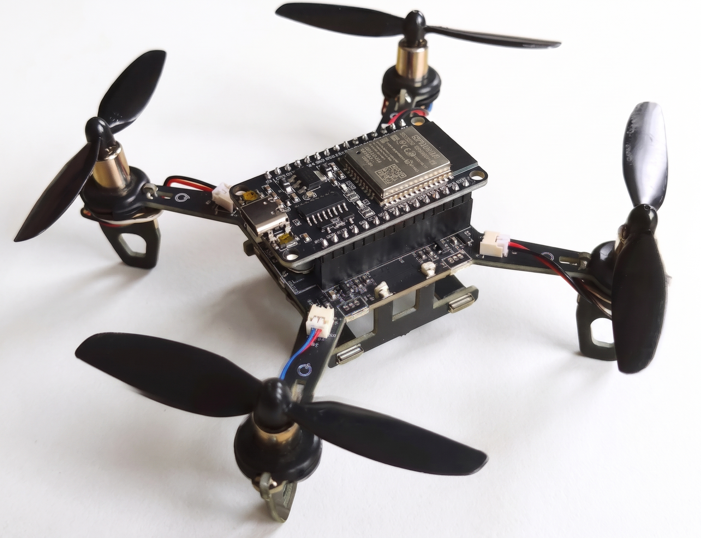
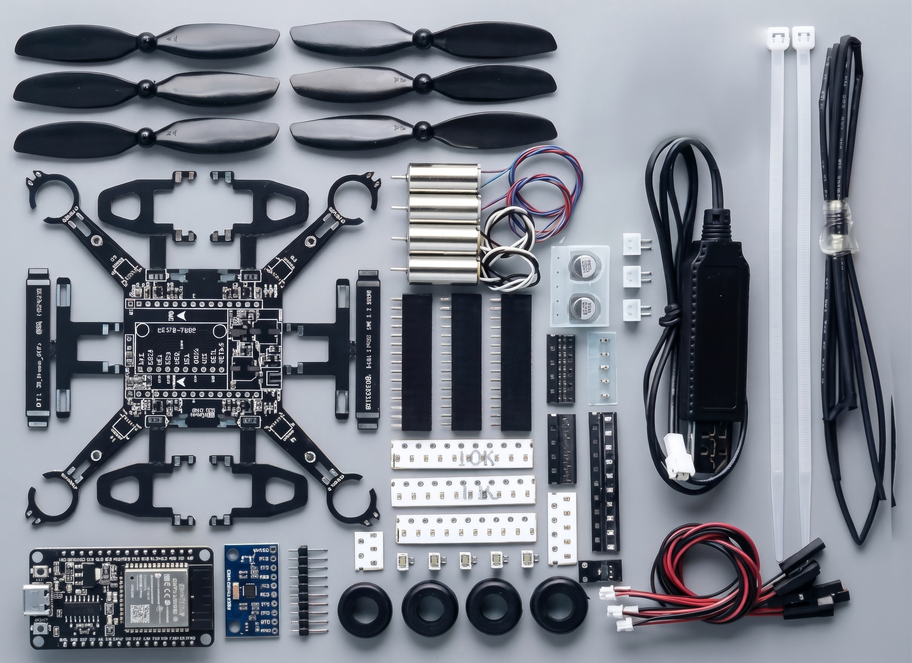
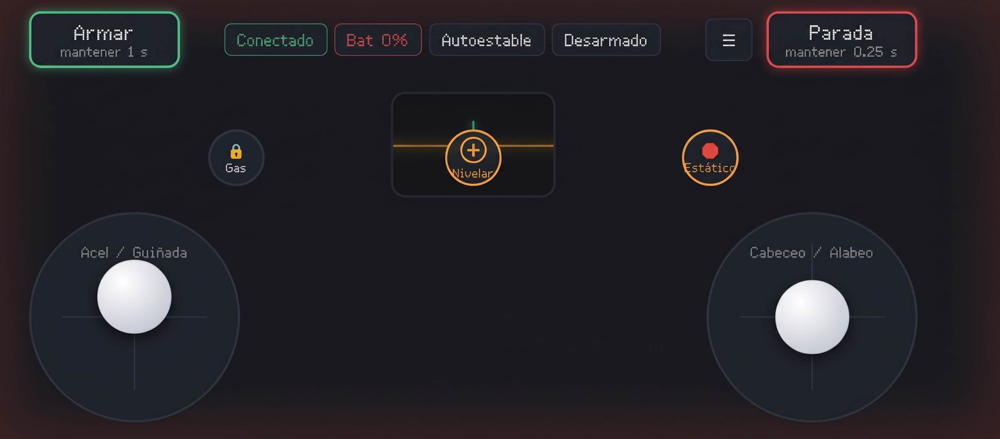

<h1 align="center">XW-Drone: Sistema de Control Web para Cuadricóptero ESP32</h1>

  
  
  
  
  

  
  
<i>Figura 1. Vista general del dron pre-ensamblado utilizado para el desarrollo del proyecto.</i>

Este proyecto consiste en el desarrollo de un firmware y una interfaz web para el control de un dron cuadricóptero. El hardware está basado en un **kit de dron pre-ensamblado** (tipo DIY de 85mm), sobre el cual se implementó toda la lógica de control, los algoritmos de vuelo y la interfaz de usuario. El sistema permite pilotar el dron en tiempo real a través de una página web alojada en el propio microcontrolador ESP32, utilizando una conexión WiFi local. El diseño está optimizado para pruebas de vuelo de precisión y competencias de obstáculos.

## Tabla de Contenidos
1. [Características Principales](#características-principales)
2. [Hardware y Componentes](#hardware-y-componentes)
3. [Detalles de Ensamble y Advertencias](#detalles-de-ensamble-y-advertencias)
4. [Arquitectura del Software](#arquitectura-del-software)
5. [Guía de la Interfaz de Vuelo](#guía-de-la-interfaz-de-vuelo)
6. [Instalación y Configuración](#instalación-y-configuración)
7. [Consejos para la Competencia](#consejos-para-la-competencia)
8. [Solución de Problemas Frecuentes](#solución-de-problemas-frecuentes)
9. [Créditos y Autoría](#créditos-y-autoría)

---

## Características Principales

- **Interfaz Web Táctil Avanzada:** Control mediante doble joystick virtual, diseñado ergonómicamente para pantallas de teléfonos y tablets en orientación horizontal.
- **Algoritmos de Vuelo (Frontend):** Implementación de suavizado de señal (Ramping), curvas exponenciales (Expo) y zonas muertas (Deadzone) directamente en JavaScript para un vuelo fluido.
- **Modos de Vuelo:** Selector de "Modo Precisión" (reducción de sensibilidad al 60% para maniobras finas) y control de "Ajuste Fino" (Trim) para compensar derivas.
- **Sistemas de Seguridad:** Botón de "Parada de Emergencia" (requiere mantener presionado 0.25s), botón de "Modo Estático" (nivela ejes y congela el gas), y Auto-Desarmado automático si el navegador pierde el foco.
- **Soporte para Gamepad:** Integración de la API de HTML5 para conectar controles físicos (Xbox, PlayStation) vía Bluetooth y aumentar la precisión de pilotaje.
- **Telemetría Básica:** Monitoreo del voltaje de la batería con alertas visuales (borde de pantalla parpadeante) en casos críticos.

---

## Hardware y Componentes

El proyecto utiliza la plataforma estándar de kits pre-ensamblados para micro-drones, compuesto por los siguientes elementos:

| Componente | Especificación / Modelo |
| :--- | :--- |
| **Microcontrolador** | ESP32 (DevKit) |
| **Motores** | 4x Coreless 8520 (2 CW, 2 CCW) |
| **Controladores de Motor** | Placa de distribución (PCB) con MOSFETs AO3416 |
| **Sensor IMU** | MPU6050 (Acelerómetro y Giroscopio) |
| **Batería** | LiPo 1S (3.7V) de alta tasa de descarga (70C a 150C) |
| **Hélices** | 55mm (Marcas A3 y B3) |
| **Estructura** | Marco de 85mm |

  
  
<i>Figura 2. Desglose de los componentes principales del dron.</i>

---

## Detalles de Ensamble y Advertencias

Aunque el hardware viene pre-ensamblado, es necesario verificar y configurar correctamente ciertos componentes antes del primer vuelo.

> [!WARNING]
> **Selección de la Batería: la tasa de descarga (C) es crítica**
>
> Batería utilizada durante el desarrollo: **LiPo 1S, 3.7 V, 750 mAh, 70C a 150C**.
>
> Las pruebas iniciales con baterías de menor tasa de descarga (**15C o 25C**) tuvieron un funcionamiento deficiente por la **Caída de Tensión (*Voltage Sag*)**. Los motores 8520 demandan **más de 10 A en picos**; si la batería no puede suministrar esa corriente, su voltaje se desploma y ocurre lo siguiente:
>
> - Los motores pierden fuerza.
> - Los motores se detienen en pleno vuelo.
> - El dron no logra despegar.
>
> **Requisito:** utilizar una batería de **70C o superior** para garantizar un voltaje estable a máxima potencia.

> [!IMPORTANT]
> **Orientación de Motores y Hélices**
>
> El PCB cuenta con indicaciones serigrafiadas (flechas de giro) que dictan la orientación exacta de cada motor.
>
> **No confíes únicamente en el color de los cables** (rojo/azul o negro/blanco): varía según el fabricante. Verifica siempre el sentido de giro contra la flecha del PCB.

**Procedimiento de verificación:**
1. **Prueba de Motores (Sin hélices):** Activa un motor a baja potencia. Verifica que el giro físico coincida con la flecha del PCB. Si gira al revés, apaga el dron e invierte la polaridad de los cables en el conector JST. Repite con los 4 motores.
2. **Prueba de Empuje (Con hélices):** Coloca las hélices (A3 o B3 según corresponda). Enciende a baja potencia y coloca la mano debajo de cada hélice. Debes sentir el aire empujando **hacia abajo**. Si el aire va hacia arriba, la hélice está invertida o en el motor equivocado.

---

## Arquitectura del Software

El proyecto está desarrollado en el entorno de Arduino IDE (C++) para el hardware, y HTML/CSS/JavaScript para el cliente.

- **Firmware (ESP32):** El código principal (`XW-Drone.ino`) gestiona el ciclo de vuelo, la lectura del IMU, los algoritmos PID y la generación de señales PWM. El servidor web corre de forma asíncrona.
- **Interfaz (Cliente):** Todo el código HTML, CSS y JS está embebido en el archivo `web_rc_html.h` como una cadena de texto (PROGMEM). La comunicación se realiza mediante peticiones HTTP POST asíncronas (`fetch`) enviadas a 20Hz para no saturar el procesador.

  
  
<i>Figura 3. Interfaz web de control en funcionamiento.</i>

---

## Guía de la Interfaz de Vuelo

- **Joystick Izquierdo:** Controla la Aceleración (eje Y) y la Guiñada/Rotación (eje X).
- **Joystick Derecho:** Controla el Cabeceo (eje Y) y el Alabeo (eje X).
- **Menú de Opciones (Icono superior derecho):**
  - *Modo Normal/Precisión:* Alterna la sensibilidad de los ejes de vuelo.
  - *Modo Minimalista:* Oculta la telemetría y botones secundarios para maximizar el área de vuelo visual.
  - *Tamaño de Joysticks:* Ajusta el diámetro de los controles.
  - *Ajuste Fino (Trim):* Compensa pequeñas derivas del dron.
- **Botones de Acción Rápida (Zona Central):**
  - *Nivelar:* Centra los ejes de vuelo instantáneamente.
  - *Gas (Candado):* Bloquea el acelerador en la posición actual (control de crucero).
  - *Estático:* Detiene todos los movimientos y bloquea el gas en caso de emergencia.
- **Botón de Parada:** Requiere mantener presionado para detener los motores inmediatamente.

---

## Instalación y Configuración

1. **Clonar el repositorio** y abrir el archivo `XW-Drone.ino` en Arduino IDE.
2. **Instalar dependencias:** Asegurarse de tener instalado el core de ESP32 en el gestor de placas y las librerías correspondientes (WebServer, WiFi, ESPmDNS, entre otras).
3. **Configurar Red WiFi:** Por defecto, el dron crea una red llamada `XW_Drone_WiFi` con contraseña `12345678`. Para cambiarla, se debe modificar el código en `Soporte Wi-Fi.txt` o mediante el monitor serie.
4. **Compilar y cargar** el código al ESP32.
5. **Conexión:** Conectar el dispositivo móvil o PC a la red WiFi del dron y abrir un navegador web en la dirección: `http://192.168.4.1:8080`.

> [!NOTE]
> **Nota para estudiantes de nuevos semestres:** Si varios equipos comparten el mismo espacio de vuelo, asegúrense de cambiar el nombre de la red (SSID) en el código para evitar conflictos de conexión.

---

## Consejos para la Competencia

- **Calibración:** Realizar siempre la calibración del IMU (MPU6050) en una superficie plana y nivelada. No calibrar sobre superficies blandas.
- **Precisión:** Utilizar el "Modo Precisión" antes de atravesar los aros y el Gamepad si se tiene acceso a uno para un control más fino.
- **Mantenimiento:** Revisar frecuentemente que las hélices no tengan fisuras y que los conectores JST de los motores estén firmemente insertados.

---

## Solución de Problemas Frecuentes

- **El dron no despega o los motores se apagan en vuelo:** La batería no puede entregar la corriente necesaria (Voltage Sag). Reemplazar por una batería de mayor tasa de descarga (C).
- **Los motores giran en sentido contrario:** Invertir la polaridad de los cables en el conector JST del motor correspondiente, verificando siempre contra la flecha del PCB.
- **La interfaz web no se actualiza:** El navegador está guardando en caché la versión antigua. Borrar los datos de navegación o abrir la página en una ventana de incógnito.
- **El dron no responde al gamepad:** Asegurarse de haber emparejado el control Bluetooth al dispositivo móvil *antes* de abrir la página web.

---

## Créditos y Autoría

Desarrollado por Eduardo Gómez Mejía / Los Onexx para el Instituto Tecnológico Superior del Occidente del Estado de Hidalgo / TERA, 2026.
Proyecto de código abierto para fines educativos y de investigación.